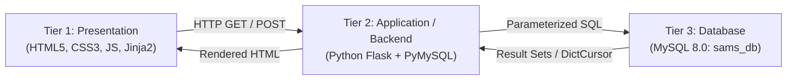
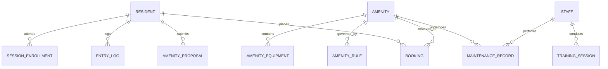

# Society Amenities Management System (SAMs) — Complete A-to-Z Guide
**DBMS Lab Experiment 10:** *Execution of CRUD Operations from Front End using RDBMS Database Connectivity*

---

## 1. Project Overview & Objective

### Objective
To build a web-based database application connected to a relational database (MySQL), demonstrating full **CRUD** (Create, Read, Update, Delete) data operations from a graphical front-end rather than raw terminal commands.

### Problem Statement
**Society Amenities Management System (SAMs)** manages residential amenities (Clubhouse, Swimming Pool, Gym, Tennis Court), resident registrations, slot reservations, maintenance requests, and security logs in a gated housing society.

### Core Entity Chosen
The **`Resident`** entity was chosen as the primary entity for CRUD operations because it is the central hub of SAMs:
- Every amenity booking references a resident (`booking.resident_id`).
- Every training program enrollment references a resident (`session_enrollment.resident_id`).
- Every facility entry swipe references a resident (`entry_log.resident_id`).
- Every new amenity proposal references a resident (`amenity_proposal.resident_id`).

---

## 2. Architecture & Data Flow

SAMs follows the industry-standard **3-Tier Architecture**:



### Flow Breakdown:
1. **User Action:** User fills an HTML form (e.g., resident registration) and clicks **Submit**.
2. **Flask Route:** Flask intercepts the `POST` request, extracts values via `request.form`, and performs validation.
3. **Database Connector (`PyMySQL`):** Opens a connection using `pymysql.connect()` with `DictCursor`.
4. **Parameterized Query Execution:** The SQL query is sent with `%s` placeholders. MySQL parses the SQL structure first, then binds the data parameters safely (preventing SQL Injection).
5. **Commit & Reflection:** MySQL executes the transaction (`autocommit=True`), and Flask redirects the user with flash feedback (`flash("Resident registered successfully!", "success")`).

---

## 3. Database Schema (`sams_db`)

The database contains 13 normalized tables adhering to 3NF:



### Table Dictionary (Key Tables)

| Table | Primary Key | Description | Key Foreign Keys & Constraints |
|---|---|---|---|
| **`resident`** | `resident_id` | Society residents | `UNIQUE(email)`, `CHECK(contact_no >= 10)`, `status IN ('Pending','Approved','Rejected')` |
| **`amenity`** | `amenity_id` | Bookable facilities | `capacity > 0`, `status IN ('Operational','Under Maintenance')` |
| **`booking`** | `booking_id` | Amenity slot reservations | FK `resident_id` ON DELETE CASCADE, FK `amenity_id` ON DELETE CASCADE |
| **`maintenance_record`**| `record_id` | Repair & upkeep tickets | FK `amenity_id`, FK `staff_id`, `cost >= 0` |
| **`staff`** | `staff_id` | Maintenance & trainers | `role IN ('Trainer','Maintenance','Security','Cleaner')` |
| **`entry_log`** | `log_id` | Facility swipe logs | FK `resident_id`, FK `amenity_id`, `check_in_time` |
| **`amenity_proposal`** | `proposal_id` | Resident feature requests | FK `resident_id`, `status IN ('Pending','Approved','Rejected')` |

---

## 4. CRUD Operations on `Resident`

Every button click in the UI directly translates into parameterized SQL:

### A. CREATE (Insert New Resident)
- **UI Location:** Top Navigation &rarr; *Register Resident* (`/register`)
- **Action:** User enters Name, Apartment No, Contact No, Email.
- **SQL Executed:**
```sql
INSERT INTO resident (resident_id, name, apartment_no, contact_no, email, status)
VALUES (106, 'Ishaan Raj Kapoor', 'C-210', '9888877777', 'ishaan.kapoor@email.com', 'Pending');
```
- **Business Logic:** New self-registrations default to status `'Pending'` until the Society Manager reviews and approves them.

---

### B. READ (Query & Display Records)
- **UI Location:** *Manager Portal* (`/manager`) &rarr; Directory & Pending tables.
- **Display all residents:**
```sql
SELECT * FROM resident ORDER BY resident_id;
```
- **Display pending approvals only:**
```sql
SELECT * FROM resident WHERE status = 'Pending' ORDER BY resident_id;
```
- **Fetch single resident for pre-filling edit form:**
```sql
SELECT * FROM resident WHERE resident_id = 101;
```

---

### C. UPDATE (Modify Existing Record)
- **UI Location:** *Manager Portal* &rarr; Resident Directory &rarr; Click **Edit** (`/residents/edit/<id>`)
- **Action:** Manager updates apartment number, phone number, or approval status.
- **SQL Executed:**
```sql
UPDATE resident
SET name = 'Aarav Mehta',
    apartment_no = 'A-102',
    contact_no = '9876543210',
    email = 'aarav.mehta@email.com',
    status = 'Approved'
WHERE resident_id = 101;
```
- **Quick Status Action (Approve/Reject Buttons):**
```sql
UPDATE resident SET status = 'Approved' WHERE resident_id = 106;
```

---

### D. DELETE (Remove Record & Cascading)
- **UI Location:** *Manager Portal* &rarr; Resident Directory &rarr; Click **Delete** (`/residents/delete/<id>`)
- **SQL Executed:**
```sql
DELETE FROM resident WHERE resident_id = 106;
```
- **Cascading Integrity:**
  Because dependent foreign keys are configured with `ON DELETE CASCADE`:
  - All bookings made by resident 106 are automatically deleted.
  - All training enrollments and entry logs are cleanly purged.
  - No orphaned records or foreign key violation errors occur.

---

## 5. Multi-Role Portals & Features

The application supports 3 distinct functional roles selectable via the top navbar dropdown:

| Portal | User Persona | Capabilities |
|---|---|---|
| **Manager Portal** | Society Admin / Secretary | • Full CRUD on residents<br>• Approve / reject pending registrations<br>• View all amenity bookings & approve requests<br>• Review resident amenity proposals<br>• Maintenance overview & stats dashboard |
| **Resident Portal** | Flat Resident | • View active amenity list & availability<br>• Book amenity slots (with auto ID generation)<br>• View personal booking history & status<br>• Submit maintenance requests & proposals |
| **Staff Portal** | Facility Staff & Trainers | • View assigned maintenance jobs<br>• Update maintenance ticket status & cost<br>• Log facility entry swipes for residents |

---

## 6. Codebase File Breakdown

```
exp10_mysql_sams/
├── app.py                # Main Flask controller: routes, CRUD handlers, session management
├── config.py             # Configuration loader: reads .env with sensible fallback defaults
├── setup_db.py           # Automated DB initializer: creates sams_db, tables, and seeds
├── schema_mysql.sql      # DDL script: 13 normalized tables, PKs, FKs, CHECK constraints
├── seed_mysql.sql        # DML script: realistic sample data (residents, bookings, staff)
├── requirements.txt      # 3 core packages: Flask, PyMySQL, cryptography
├── .env.example          # Sample environment variables file
├── .env                  # Local credentials (ignored by Git)
├── static/
│   ├── style.css         # Modern, responsive, offline-ready UI design (zero CDN dependency)
│   └── app.js            # Light/Dark mode switcher & tab persistence logic
└── templates/
    ├── base.html         # Base layout: navbar, role-switcher, flash alerts, theme toggle
    ├── _macros.html      # Reusable Jinja2 UI macros (badges, stats cards, tables)
    ├── manager.html      # Manager dashboard: stats, approval queue, resident directory
    ├── resident.html     # Resident interface: slot booking & history
    ├── staff.html        # Staff interface: work orders & entry logger
    ├── register.html     # New resident registration form (Create)
    └── edit_resident.html# Resident update form (Update)
```

---

## 7. Step-by-Step Running Guide

### Scenario A: Running on Your Laptop
1. Open terminal:
   ```bash
   cd "/home/kaustubh/Desktop/dbms lab/exp10_mysql_sams"
   source venv/bin/activate
   ```
2. Initialize database:
   ```bash
   python setup_db.py
   ```
   *Input prompt:*
   - Host `[localhost]`: Press **Enter**
   - User `[root]`: Type `sams`
   - Password: Type `krs312`
3. Run the app:
   ```bash
   python app.py
   ```
4. Visit `http://localhost:5000`.

---

### Scenario B: Running on Any College Computer
1. Clone the repository:
   ```bash
   git clone https://github.com/krs-kaustubh/dbms_exp10.git
   cd dbms_exp10
   ```
2. Create & activate virtual environment:
   ```bash
   python3 -m venv venv
   source venv/bin/activate       # On Windows: venv\Scripts\activate
   ```
3. Install dependencies:
   ```bash
   pip install -r requirements.txt
   ```
4. Run setup script:
   ```bash
   python setup_db.py
   ```
   *Input prompt:*
   - Host `[localhost]`: Press **Enter**
   - User `[root]`: Press **Enter**
   - Password: Press **Enter** (if lab PC has no MySQL password) or enter the lab password.
5. Launch portal:
   ```bash
   python app.py
   ```
6. Open browser at `http://localhost:5000`.
   *Works 100% offline — all CSS, JavaScript, and fonts are locally hosted.*

---

## 8. Security & Engineering Best Practices

1. **SQL Injection Protection:**
   Never concatenate query strings like `f"SELECT * FROM resident WHERE name = '{name}'"`.
   Always use parameterized placeholders:
   ```python
   cur.execute("SELECT * FROM resident WHERE email = %s;", (email,))
   ```
2. **Credential Isolation:**
   Passwords and database names are never hardcoded. They live in `.env` (git-ignored) and are loaded through `config.py`.
3. **Database Independence:**
   Database name is isolated to `sams_db`, ensuring it never conflicts with previous lab experiments (`societydb`).
4. **Data Integrity via Constraints:**
   - `PRIMARY KEY`: Guarantees unique entity identification.
   - `UNIQUE(email)`: Prevents duplicate resident registrations.
   - `CHECK(CHAR_LENGTH(contact_no) >= 10)`: Rejects malformed phone numbers at database level.
   - `ON DELETE CASCADE`: Prevents dangling references when entities are deleted.

---

## 9. Top Viva & Lab Examination Questions

| Question | Examiner's Expected Answer |
|---|---|
| **Q1: What is the purpose of PyMySQL?** | It is a pure-Python MySQL client library that implements the Python DB-API 2.0 specification, allowing Python code to open sockets, send SQL statements to MySQL, and fetch results as Python dictionaries or tuples. |
| **Q2: Why use parameterized queries (`%s`) instead of f-strings?** | Parameterized queries separate SQL logic from user data. The database driver escapes characters automatically, rendering SQL injection impossible. |
| **Q3: What does `autocommit=True` do?** | It ensures that DML operations (`INSERT`, `UPDATE`, `DELETE`) are immediately committed to disk without requiring an explicit `conn.commit()` call after each execution. |
| **Q4: How does `ON DELETE CASCADE` work in your app?** | When a resident is deleted via `DELETE FROM resident WHERE resident_id = %s`, MySQL's storage engine automatically removes all matching child rows in `booking`, `entry_log`, and `session_enrollment` in the same transaction. |
| **Q5: What is the difference between GET and POST in your forms?** | `GET` requests are idempotent and used to retrieve views (e.g., viewing `/manager` or `/residents/edit/101`). `POST` requests send data in the HTTP request body to cause state changes on the server (e.g., submitting `/register` or `/residents/delete/101`). |
| **Q6: Why is `.env` added to `.gitignore`?** | To prevent private database credentials and secrets from being committed into version control or leaked to public GitHub repositories. |
